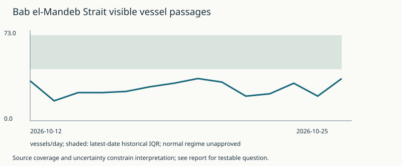

# River City Daily: PortWatch

**Establishes:** The source records 36 vessels/day at its latest observation; 14 finite observations inform this diagnostic window.

**Does not establish:** an approved normal regime, true unobserved traffic, deliverability, or a causal explanation.

**Question:** Would more comparable historical observations narrow the comparison enough to distinguish these alternatives?

**Diagnostic flags:** regime-unknown, uncertain, unexplained. Source age: 3 days.

Research attempts this report: 2; retained attempts: 4. Suppressed: [].

- `portwatch/chokepoint4`: **completed**. 2 retained search responses; 4 candidate references. [Dossier](../../data/research/research-e160cc1e5091be53dc650556358d19578c7c37fa08d78b449c0c21fe23c82a9f/result.edn).
- `portwatch/chokepoint6`: **completed**. 2 retained search responses; 4 candidate references. [Dossier](../../data/research/research-77224a3ce6df44cf4f3f14b156528fe4d5be151556ad704c269777e221a5962a/result.edn).

Retained research: [`portwatch/chokepoint6` completed](../../data/research/research-77224a3ce6df44cf4f3f14b156528fe4d5be151556ad704c269777e221a5962a/result.edn); [`portwatch/chokepoint4` completed](../../data/research/research-e160cc1e5091be53dc650556358d19578c7c37fa08d78b449c0c21fe23c82a9f/result.edn); [`portwatch/chokepoint4` completed](../../data/research/research-aed82fa1ddd0eb1e7ccb389734511822c94cacad7bd06034554892e68ab4f20e/result.edn); [`portwatch/chokepoint6` completed](../../data/research/research-bba0aaf799f16362442220e4335a1b79e489554f46e80377e30ed38c011ca2fb/result.edn).

Literature metadata supplies leads, not verified experimental findings. Null searches remain valid; failed searches remain failures. Proposed indicators/tests do not modify production definitions. Foresight/Clio event admission is explicitly pending.

Generated: `2026-10-28T18:24:00.611603759Z`

Source coverage through: `2026-10-25`

## Status

| Chokepoint | Date | Visible vessels | Prior-year median | Deviation | Baseline n |
|---|---:|---:|---:|---:|---:|
| Bab el-Mandeb Strait | 2026-10-25 | 36 | 46.0 | -21.7% | 7 |
| Strait of Hormuz | 2026-10-25 | 2 | 84.0 | -97.6% | 7 |

## Stable artifacts

- Projection: [`projections/portwatch/latest.edn`](../../projections/portwatch/latest.edn)
- JSON projection: [`projections/portwatch/latest.json`](../../projections/portwatch/latest.json)
- Passage chart: [`charts/portwatch/passage-vs-history.vl.json`](../../charts/portwatch/passage-vs-history.vl.json)
- Deviation chart: [`charts/portwatch/deviation-from-history.vl.json`](../../charts/portwatch/deviation-from-history.vl.json)
- Vessel mix chart: [`charts/portwatch/cargo-mix.vl.json`](../../charts/portwatch/cargo-mix.vl.json)
- Map spec: [`charts/portwatch/map.vl.json`](../../charts/portwatch/map.vl.json)
- GeoJSON: [`maps/portwatch/latest.geojson`](../../maps/portwatch/latest.geojson)

## Interpretation constraints

- The baseline is the same calendar day across all prior available years, shown as median and IQR. It is descriptive and provisional, not an approved normal-regime policy. See issue #3.
- This repository snapshot is directly derived from the upstream source. Clio/Foresight event hosting remains the intended canonical ledger path; the manifest marks this snapshot as not yet ledger-backed.
- Missing or dark traffic is not converted into zero. Source revisions should be retained by the eventual Clio history.
